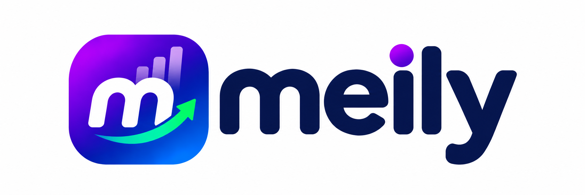

<p align="center">
  
</p>

<p align="center">
  <strong>Gestão financeira e operacional simples para Microempreendedores Individuais (MEI)</strong>
</p>

<p align="center">
  <a href="https://github.com/filipe-brochier/meily/actions/workflows/tests.yml">
    
  </a>
  
  
  
  
  
</p>

---

## 📖 Sobre o projeto

**Meily** é um sistema web de **gestão unificada** desenvolvido para Microempreendedores Individuais (MEI) — com foco inicial na comunidade de **Novo Hamburgo – RS** — que hoje organizam clientes, agenda e finanças em cadernos, planilhas soltas ou conversas de WhatsApp.

O projeto nasceu como **Trabalho de Atividade Extensionista II** do curso de **Análise e Desenvolvimento de Sistemas** do **Centro Universitário Internacional UNINTER**, alinhado aos Objetivos de Desenvolvimento Sustentável:

- **ODS 8** — Trabalho decente e crescimento econômico
- **ODS 9** — Indústria, inovação e infraestrutura

A proposta é oferecer, em um único lugar, o controle de **clientes**, **produtos/serviços**, **agenda** e **histórico financeiro**, com uma interface simples o suficiente para quem não tem familiaridade com sistemas de gestão — promovendo inclusão digital e profissionalização do pequeno negócio.

## ✨ Funcionalidades

- **Dashboard** — resumo do mês atual (entradas, saídas e saldo), fluxo de caixa dos últimos 6 meses, lançamentos recentes e próximos agendamentos.
- **Clientes** — cadastro, edição e exclusão (soft delete) de clientes, com nome, telefone, e-mail e endereço.
- **Produtos e Serviços** (*offerings*) — catálogo de ofertas com preço, categoria e status ativo/inativo.
- **Agenda** (*events*) — agendamento de atendimentos vinculados a cliente e serviço, com data, horário e status.
- **Histórico financeiro** (*transactions*) — lançamentos de entrada e saída, com:
  - categorização (serviço, produto, consultoria, transporte, contas, etc.);
  - status `pago`, `pendente` e `cancelado`;
  - **cancelar** um lançamento sem perder o histórico (e reativá-lo para `pendente` quando necessário);
  - **excluir** um lançamento via soft delete, preservando o registro no banco para auditoria.
- **Autenticação completa** — cadastro, login, verificação de e-mail por código, recuperação de senha, confirmação de senha, **autenticação em duas etapas (2FA)** e **passkeys** (WebAuthn), via Laravel Fortify.
- **Preferências de conta** — edição de perfil, segurança e aparência (tema claro/escuro).

## 🧱 Stack técnica

| Camada | Tecnologias |
| --- | --- |
| Backend | PHP 8.3+, [Laravel 13](https://laravel.com), [Laravel Fortify](https://laravel.com/docs/fortify) (auth/2FA/passkeys) |
| Frontend | [React 19](https://react.dev), [Inertia.js 3](https://inertiajs.com), TypeScript, Tailwind CSS 4 |
| Roteamento tipado | [Laravel Wayfinder](https://github.com/laravel/wayfinder) — gera funções TS a partir das rotas/controllers |
| Banco de dados | SQLite (padrão local) ou MySQL — modelagem relacional via Eloquent/Migrations |
| Testes | [Pest](https://pestphp.com) (PHP) — 150+ testes de feature cobrindo autenticação, autorização e regras de negócio |
| Qualidade | Laravel Pint (estilo de código), Larastan/PHPStan (análise estática), CI no GitHub Actions |

## 🚀 Como rodar o projeto

### Pré-requisitos

- PHP >= 8.3 com Composer
- Node.js >= 20 com npm
- SQLite (padrão) ou MySQL

### Passo a passo

```bash
# 1. Clone o repositório
git clone https://github.com/filipe-brochier/meily.git
cd meily

# 2. Instale as dependências e configure o ambiente (Composer faz tudo: .env, key, migrations, build)
composer setup

# 3. Suba o servidor de desenvolvimento (Laravel + Vite + filas + logs em um só comando)
composer dev
```

Após isso, acesse **http://localhost:8000**.

<details>
<summary>Configuração manual (passo a passo detalhado)</summary>

```bash
composer install
cp .env.example .env
php artisan key:generate

# banco de dados (SQLite por padrão)
touch database/database.sqlite
php artisan migrate

npm install
npm run build   # ou: npm run dev, para hot-reload durante o desenvolvimento

php artisan serve
```

</details>

### Rodando os testes

```bash
php artisan test            # suíte completa (Pest)
php artisan test --filter=Transaction   # apenas um conjunto de testes
composer ci:check           # estilo (Pint) + análise estática (PHPStan) + testes
```

## 📂 Estrutura do projeto

```
app/
├── Http/Controllers/   # Controllers (Dashboard, Clients, Offerings, Events, Transactions...)
├── Models/             # Eloquent models (User, Client, Offering, Event, Transaction, Category)
└── Policies/           # Autorização por recurso (um usuário só acessa os seus próprios dados)

database/migrations/    # Esquema do banco (relacional)

resources/js/
├── pages/              # Telas Inertia (dashboard, clients, offerings, events, transactions...)
└── components/         # Componentes de UI reutilizáveis

routes/web.php          # Rotas da aplicação

tests/Feature/          # Testes de feature (Pest)
```

## 🎓 Contexto acadêmico

| Campo | Valor |
| --- | --- |
| Instituição | Centro Universitário Internacional UNINTER |
| Curso | CST em Análise e Desenvolvimento de Sistemas |
| Disciplina | Atividade Extensionista II: Tecnologia Aplicada à Inclusão Digital – Projeto |
| Aluno | Filipe Brochier (RU 4284328) |
| Setor de aplicação | Microempreendedores Individuais (MEI) de Novo Hamburgo – RS |

## 📝 Licença

Este projeto é disponibilizado sob a licença [MIT](LICENSE).
